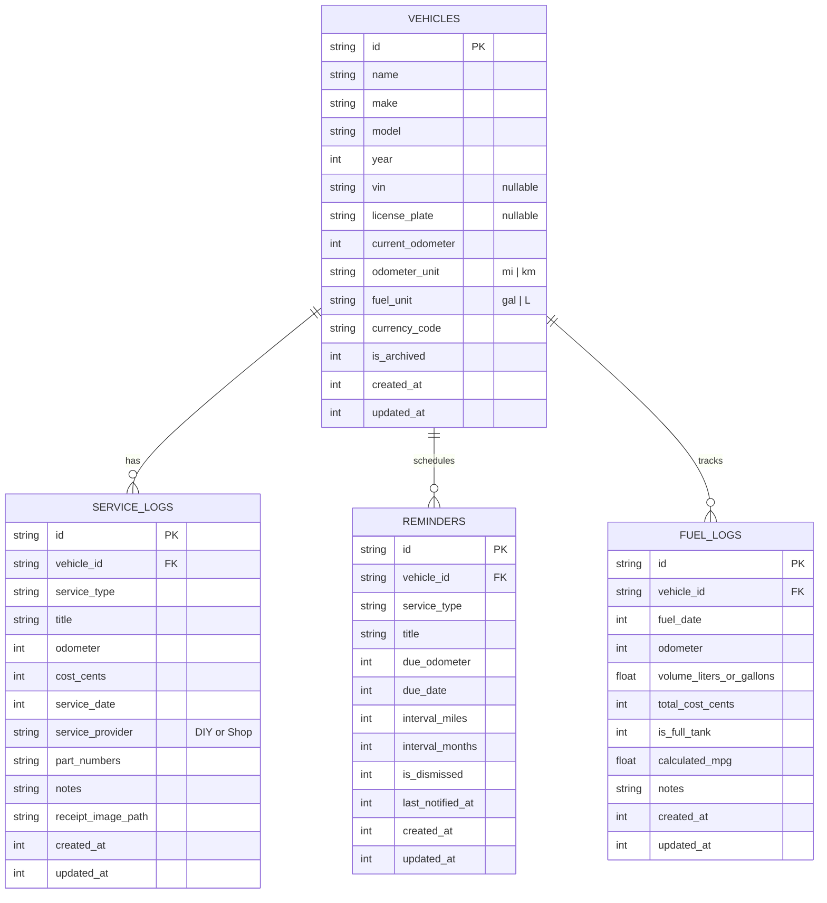

# Architecture: Vehicle Maintenance App - Noin (Zero-Server, 100% Free-to-Run Native Android App)

> **Core Philosophy:** True Local-First Native Android. Every byte of vehicle data lives on the user's phone in a native Room SQLite database.
> **Total Monthly Operating / Cloud Bill: $0.00 / month.**
> You only pay the one-time **$25 Google Play Developer account fee** to publish. Zero recurring API fees, zero cloud database bills, zero server hosting costs.

---

## 1. Zero-Cost Technology Stack

| Layer | Choice | Why & Cost Breakdown |
|---|---|---|
| **OS / Platform** | **Native Android (Kotlin)** | 100% free open-source tools (Android Studio, Kotlin, Gradle). No React Native / Flutter bridge overhead. Maximum battery efficiency and native feel. |
| **UI Framework** | **Jetpack Compose + Material 3** | Google's modern declarative UI. Free. Delivers fluid animations, instant dark mode, and responsive layouts for phones & tablets with zero third-party UI libraries. |
| **Local Database** | **Room (SQLite on-device)** | Free. Robust Google-supported SQLite abstraction. Type-safe queries, migration support, reactive Kotlin `Flow` data streams. Data stays on the device. |
| **Background Jobs** | **Android WorkManager** | Free. OS-native background scheduling for maintenance notifications. Respects Android battery optimization (Doze mode) without running a costly cloud push notification server. |
| **Document Engine** | **Android Native `PdfDocument`** | Free. Built right into the Android SDK framework (`android.graphics.pdf.PdfDocument`). Generates crisp, printable PDF Resale Dossiers directly on-device with zero external paid APIs. |
| **In-App Billing** | **Google Play Billing Library 7.x** | Free SDK. Google only takes a cut (**15% under the 15% tier**) *when* a user buys the $19.99 lifetime pass or $2.99/mo subscription. If you make $0, you pay $0. |
| **Cloud Backup (Optional)** | **Android Auto-Backup / Google Drive API** | Free. Users backup directly into their *own* private Google Drive account or Android OS auto-backup. Zero server storage cost to you. |
| **Crash & Analytics** | **Firebase Crashlytics (Spark Plan)** | Free. Generous, permanent free tier for crash monitoring and diagnostic traces without ads or fees. |

---

## 2. Database Schema (Room SQLite)

The schema operates with **4 focused tables** with cascading foreign keys and indexes. (See complete SQL in [replica/schema.sql](file:///d:/Project01/replica/schema.sql)).

---

## 3. Screen Inventory & Flow Architecture

Because the app is local-first, the architecture uses a clean **Single Activity + Jetpack Compose Navigation Graph** powered by ViewModel-backed Repositories:

| Screen ID | Screen Name | Key Components / Actions | Data Flow |
|---|---|---|---|
| **S01** | **Garage Home** | Vehicle carousel/cards, health summary badge, overdue alert banner, bottom navigation | Observes `vehicles` & active `reminders` via Kotlin Flow |
| **S02** | **Vehicle Detail Bay** | Current odometer widget, service timeline, maintenance status, quick action row | Reads vehicle metrics & recent 10 service logs |
| **S03** | **Quick Log Entry** | Quick tiles (*Oil*, *Brakes*, *Tires*, *Battery*, *Custom*), date picker, odometer input, cost field, part numbers, photo attach | Writes new record to `service_logs`, auto-updates `vehicles.current_odometer` |
| **S04** | **Reminders & Schedule** | List of pending & past alerts, "+ Add Reminder" modal, mileage and/or calendar interval selectors | Inserts/updates `reminders`, registers notification schedule via `WorkManager` |
| **S05** | **Fuel & Mileage Log** | Fuel list, mileage calculator, simple MPG / L/100km trend chart | Appends to `fuel_logs`, calculates delta odometer / volume |
| **S06** | **Dossier & Export Center** | Date range filter, include receipts toggle, "Generate Buyer PDF" button, "Export CSV/JSON" button | Queries all service logs, draws formatted multi-page PDF via `PdfDocument`, triggers Android Share Sheet |
| **S07** | **Garage Settings & Lifetime Pro** | Unit toggles (Miles/Km, Gallons/Liters), currency selector, Google Drive backup toggle, Google Play Billing paywall card | Manages `DataStore` preferences and processes `BillingClient` purchases |

---

## 4. Background Services & Native Workers

| Worker | Trigger / Schedule | Execution Details | Cost |
|---|---|---|---|
| `MaintenanceReminderWorker` | Periodic (Every 24 hours at 09:00 AM) | Queries `reminders` table for items where `due_date <= now` or predicted odometer exceeded. Posts local Android Notification. | $0.00 (On-device) |
| `OdometerPredictor` | On each new Fuel or Service entry | Calculates daily average mileage from recent entries to estimate date when `due_odometer` will be reached. | $0.00 (On-device math) |
| `DossierPdfGenerator` | User-initiated background coroutine | Formats vehicle spec header, maintenance table, part numbers, and total expenditure into a PDF file in app cache. | $0.00 (Android SDK) |

---

## 5. The Parts That Bite (And How We Solve Them)

1. **Android Doze Mode & Battery Optimization:**
   * *Problem:* Android kills background services, leading to missed maintenance alerts.
   * *Fix:* We don't run continuous background GPS or persistent wake-locks. We use `WorkManager` with `ExistingPeriodicWorkPolicy.KEEP` and standard calendar alarm triggers that wake up gracefully once per day.
2. **Odometer Discrepancies & Unit Switching (Miles $\leftrightarrow$ Kilometers):**
   * *Problem:* Switching units in settings can corrupt existing historical logs.
   * *Fix:* All numerical values are stored alongside their native unit in the database row, or standardized at the display presentation layer using explicit formatting extensions.
3. **Receipt Photos Bloating App Storage:**
   * *Problem:* High-resolution camera photos (5–10MB each) quickly fill phone storage.
   * *Fix:* The app compresses attached receipt photos locally to 1080p WebP/JPEG (~200KB) before saving to the app's internal private storage directory (`context.filesDir/receipts/`).
4. **Data Portability / Zero Hostage Guarantee:**
   * *Problem:* Users fear being locked in or losing data when upgrading phones.
   * *Fix:* Clean JSON/CSV export and import functions conform to standard schema fields. Users can back up to their personal Google Drive or download files locally with zero subscription gate.

---

## 6. Build Order & Milestones

### Milestone 1: The Core Vertical Slice (1–2 Weeks)
* **Objective:** Establish the foundation and prove the offline loop end-to-end.
* **Scope:**
  * Setup Kotlin Gradle project with Jetpack Compose & Material 3.
  * Room database setup (`Vehicle` and `ServiceLog` entities).
  * Build **S01 (Garage Home)** + **S03 (Quick Log Entry)**.
  * Verify user can create a car, log an oil change with cost and odometer, and see it rendered immediately.

### Milestone 2: Reminders & Notifications (1 Week)
* **Objective:** Deliver proactive maintenance tracking.
* **Scope:**
  * `Reminder` database entity and DAO.
  * **S04 (Reminders Screen)** with date/mileage interval inputs.
  * Integrate `WorkManager` to trigger native Android notifications when service is due.

### Milestone 3: The Resale Dossier & Export Engine (1 Week)
* **Objective:** Build the killer conversion feature.
* **Scope:**
  * Native PDF generation using Android's `PdfDocument`.
  * Multi-page formatting with vehicle badge, chronological service ledger, and total cost breakdown.
  * CSV export/import via Android `Storage Access Framework` (SAF).

### Milestone 4: Polish, Billing & Play Store Prep (1 Week)
* **Objective:** Ready for production release.
* **Scope:**
  * Fuel logging and mileage calculation (S05).
  * Google Play Billing integration (Free 1 car $\rightarrow$ $19.99 Lifetime or $2.99/mo).
  * Test on multiple screen densities and Android versions (API 26 to 35).
